<div align="center">

<picture>
  <source media="(prefers-color-scheme: dark)" srcset=".github/assets/banner-dark.svg">
  
</picture>

**One strict PHP contract for Health Connect and HealthKit.**<br>
Request scoped authorization and read or write health records through privacy-conscious, lifecycle-safe native operations.

[](https://packagist.org/packages/pushinbr/pam-native-health)
[](https://github.com/push-in/pam-native-health/releases/latest)

[](https://github.com/push-in/pam-native-health/actions/workflows/ci.yml)
[](LICENSE)

[Install](#install) · [Quick example](#quick-example) · [Platforms](#platform-support) · [Permissions](#requirements) · [Reference](docs/reference.md) · [Issues](https://github.com/push-in/pam-native-health/issues)

</div>

<a id="install"></a>
## <picture></picture> Install

Inside a PAM Native project, add only this capability:

```sh
pam composer require pushinbr/pam-native-health
pam doctor --fix
```

PAM Native autolinks Health Connect on Android and HealthKit, usage descriptions, and entitlements on iOS. The application still controls when the system authorization UI appears.

New to PAM? Create a project with `pam init my-app --template native` (see the [PAM Native overview](https://push-in.github.io/pam-docs/native/overview/)), then come back here.

<a id="quick-example"></a>
## <picture></picture> Quick example

```php
use Pam\Native\Health\Health;
use Pam\Native\Health\HealthDataType;

$health = new Health();
$types = [HealthDataType::Steps, HealthDataType::HeartRate];

$health->requestAuthorization($types, [], function (bool $granted, ?string $error) use ($health): void {
    if (!$granted) {
        return;
    }

    $health->read(
        HealthDataType::Steps,
        (time() - 86400) * 1000,
        time() * 1000,
        fn (array $samples) => renderDailySteps($samples),
    );
});
```

Supported typed data: steps, heart rate, weight, active calories and sleep. HealthKit intentionally does not reveal denied read access, so the API exposes `needsAuthorization()` rather than claiming a read permission is granted. Empty reads may mean no data or no accessible data.

<a id="platform-support"></a>
## <picture></picture> Platform support

| Platform | Support | Notes |
| --- | --- | --- |
| Android | API 26+ | Health Connect client 1.1.0 |
| iOS | 15.0+ | HealthKit, with entitlements |
| PAM Native | 0.8.0 to < 2.0.0 | From `pam-native.plugin.json`; PHP 8.5+ |

<a id="requirements"></a>
## <picture></picture> Permissions and requirements

| Platform | Declared by the plugin |
| --- | --- |
| Android | `android.permission.health.READ_*` and `WRITE_*` for `STEPS`, `HEART_RATE`, `WEIGHT`, `ACTIVE_CALORIES_BURNED` and `SLEEP` |
| iOS | `NSHealthShareUsageDescription` ("Allow this app to read the health data you choose."), `NSHealthUpdateUsageDescription` ("Allow this app to save health data you choose."), HealthKit entitlement (`ios/App.entitlements`) |

Authorization is granular and requested only for the enum types the app supplies. Treat all health data as sensitive, minimize retention, and never log samples by default.

<a id="what-you-can-build"></a>
## <picture></picture> What you can build

- Fitness and recovery applications
- Connected wellness devices and dashboards
- User-consented health data synchronization

| | |
| --- | --- |
| **Native path** | Health Connect · HealthKit |
| **Application model** | Composer package + generated native integration |
| **Design rule** | Independent module; no feed, vertical, or application template bundled |

| API | Responsibility |
| --- | --- |
| `Health` | Check availability, request authorization, read, and write samples. |
| `HealthDataType` | Typed steps, heart rate, weight, calories, and sleep identifiers. |
| `HealthSample` | Normalized timestamped health value. |
| `HealthAvailability` | Typed platform availability result. |

<a id="production-checklist"></a>
## <picture></picture> Production checklist

- Request only the data types required by the current feature.
- Explain the value before opening the operating-system permission sheet.
- Minimize retention and exclude health values from logs and analytics.
- Run `pam doctor`, `pam test`, and a signed release build on every supported platform.
- Exercise denial, cancellation, backgrounding, process restart, and offline behavior on physical devices before release.

Platform SDKs, credentials, entitlements, physical hardware, and store configuration remain application responsibilities. Report security vulnerabilities through GitHub private vulnerability reporting, not a public issue.

<a id="docs"></a>
## <picture></picture> Docs

- [Reference](docs/reference.md): install details, API guide, troubleshooting
- [PAM Native overview](https://push-in.github.io/pam-docs/native/overview/)
- [Plugin and native capability model](https://push-in.github.io/pam-docs/native/plugins/)
- [Changelog](CHANGELOG.md)
- [Report an issue](https://github.com/push-in/pam-native-health/issues)

<a id="pam-ecosystem"></a>
## <picture></picture> Part of the PAM ecosystem

<p align="center"><picture>
  <source media="(prefers-color-scheme: dark)" srcset=".github/assets/pam-wordmark-dark.svg">
  
</picture></p>

PAM runs PHP natively on servers, desktops and phones. This repository is one piece of it.

| [**PAM**](https://github.com/push-in/pam) | [**PAM Desktop**](https://github.com/push-in/pam-desktop) | [**PAM Native**](https://github.com/push-in/pam-native) | [**Ecosystem**](https://github.com/push-in/pam#ecosystem) |
| --- | --- | --- | --- |
| the runtime and CLI | native desktop apps in PHP | native Android and iOS apps in PHP | every official package and plugin |

<sub>Docs: [push-in.github.io/pam-docs](https://push-in.github.io/pam-docs/introduction/) · [Issues](https://github.com/push-in/pam-native-health/issues)</sub>

<p align="center"><sub><a href="LICENSE">Apache License 2.0</a> · Made in Brazil by Pushin</sub></p>
